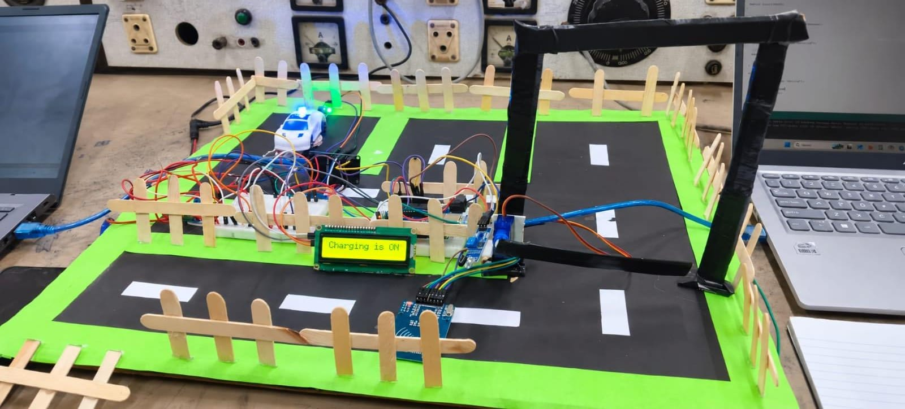
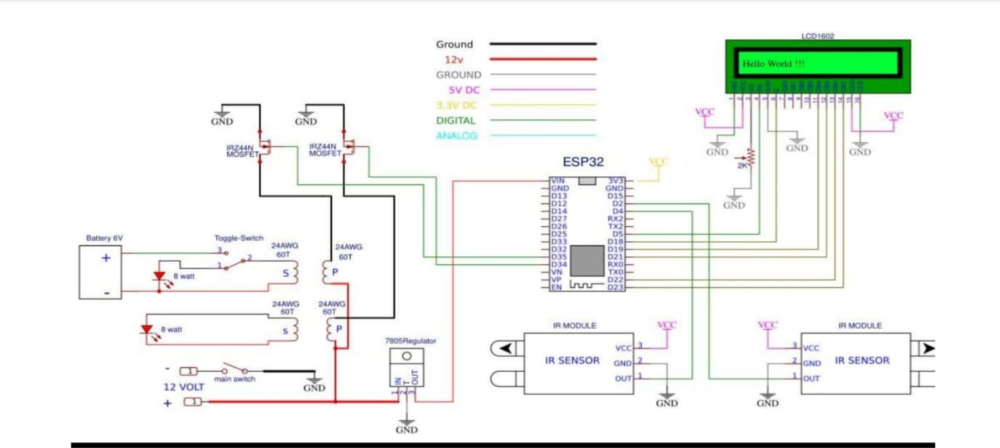
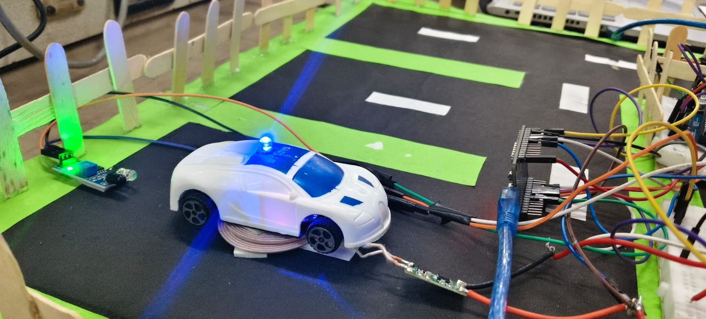
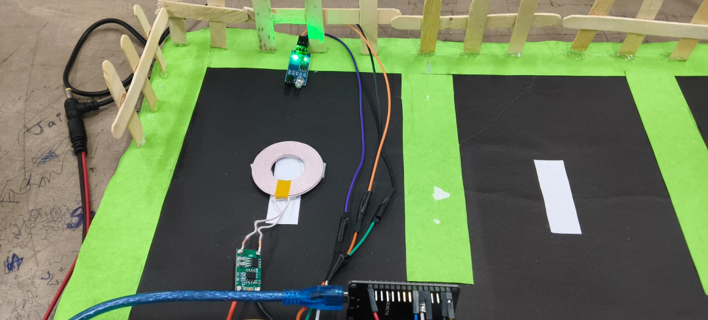

# smart-wireless-ev-charging
ESP32-based EV charging and smart parking academic project

# ⚡ Smart Wireless EV Charging Parking System

An IoT-based academic project integrating smart parking management, wireless EV charging, and real-time voltage and current monitoring using ESP32.

## 📌 Project Overview

This project combines automated parking management with wireless power transfer and IoT-based monitoring. The system uses an ESP32 microcontroller to interface with sensors, RFID, charging components, and the Blynk IoT platform.

## ✨ Key Features

- 🚗 Vehicle detection and parking management
- 🔐 RFID-based vehicle authentication
- ⚡ Wireless power transfer using transmitter and receiver coils
- 📊 Voltage and current measurement
- 📱 Remote monitoring through the Blynk IoT app
- 🖥️ LCD-based status display
- 🚧 Servo-controlled parking gate

## 📸 Complete Project Setup

*Complete hardware prototype of the Smart Wireless EV Charging Parking System.*

## 🔧 Hardware Components

| S.No. | Component | Specification | Qty. | Function |
|---:|---|---|---:|---|
| 1 | ESP32 DevKit V1 | Wi-Fi and Bluetooth | 1 | Main controller |
| 2 | Wireless Charging Transmitter | 5V, 5W module | 1 | Transmits wireless power |
| 3 | Wireless Charging Receiver | 5V output module | 1 | Receives wireless power |
| 4 | IR Sensor FC-51 | 3–5V | 2 | Vehicle detection |
| 5 | Servo Motor SG90 | 5V | 1 | Gate control |
| 6 | Relay Module | 5V | 1 | Controls transmitter power |
| 7 | ACS712 Current Sensor | 5A version | 1 | Measures current |
| 8 | Voltage Sensor | 0–25V module | 1 | Measures voltage |
| 9 | LCD 16×2 with I2C | I2C interface | 1 | Displays system status |
| 10 | DC Adapter | 5V supply | 2 | Powers system modules |

*Verify specifications and quantities against your actual hardware before publishing.*

## ⚙️ Working Principle

1. The entry sensor detects a vehicle.
2. The RFID module checks the vehicle's access card.
3. Parking sensors help determine slot availability.
4. The servo motor controls the parking gate according to the system logic.
5. The transmitter and receiver coils transfer power wirelessly.
6. Voltage and current sensors measure electrical parameters.
7. ESP32 sends the readings to the Blynk IoT app.
8. The LCD displays the relevant system status.

## 🔌 Circuit Connections

*Circuit and hardware connections used in the prototype.*

## 📷 Project Gallery

### Hardware View 1

### Hardware View 2

### Hardware View 3

## 📱 IoT Monitoring with Blynk

Voltage and current sensor readings are displayed on the Blynk app for remote monitoring.

Upload a screenshot of your actual Blynk dashboard to this repository to display it here.

## 🎥 Working Demonstration

A short video demonstrating the project is available below.

[▶ View the complete project demonstration video](vedio.mp4)

Note: GitHub may open the video as a file page instead of playing it directly in the README.

## 🛠️ Technologies Used

- ESP32 and Arduino IDE
- Embedded Systems
- RFID and Sensor Interfacing
- Blynk IoT Platform
- I2C Communication
- Wireless Power Transfer
- Hardware Integration and Testing

## 🚀 Future Improvements

- Improved charging efficiency
- Energy consumption logging
- Enhanced parking monitoring
- Improved fault detection and safety
- Expanded parking management features

## 📌 Project Status

Academic prototype. Refer to the uploaded photographs and demonstration video for the implemented system features.

## 👩‍💻 Author

**Khyati Singh**  
Electronics and IoT Engineering Student

---

⭐ *Learning, building, and exploring practical electronics and IoT solutions.*
